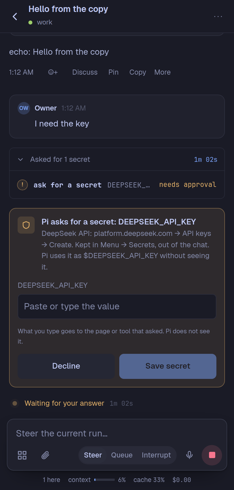
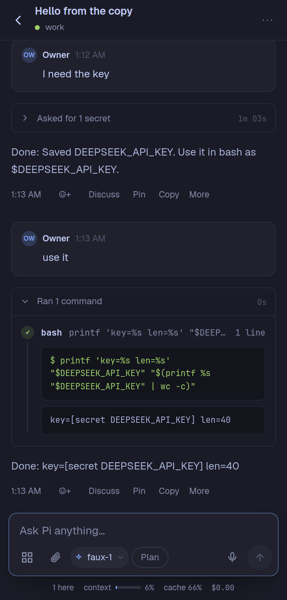
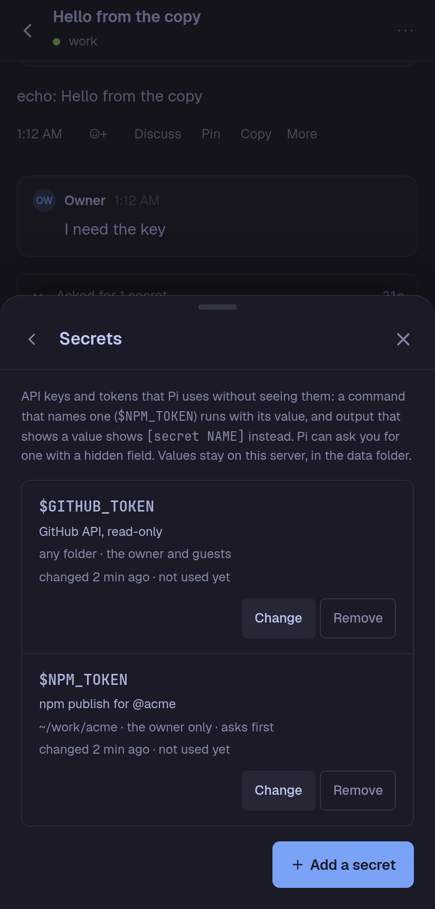

# Secrets for Pi Pocket

API keys and tokens that Pi uses without seeing them. A drop-in extension for [Pi Pocket](https://github.com/TannerMidd/pi-pocket) 0.22.0 or later, from the gallery.

<p>



</p>

## What it does

- **Keep:** Menu → **Secrets** (the owner only). Each secret has a name that is an environment variable's (`DEEPSEEK_API_KEY`), a value, what it is for, the folders where it may be used (none: anywhere), "guests' messages may use it too", and "ask before each command that uses it".
- **Use:** Pi writes `$NAME` (or `${NAME}`) in a bash command. Only the secrets that the command names go into its environment. The stored call keeps the name, not the value.
- **Hide:** the value, its base64, base64url, and URL-encoded forms show as `[secret NAME]` in command output as it streams, in every tool's result, and in a message that someone pastes a value into.
- **Ask:** `secret_request` shows the owner a card with a hidden field. The owner types the value and taps **Save secret**. Pi gets "saved", never the value.
- **Save from a command:** `secret_save` runs a command (`gh auth token`, `openssl rand -hex 32`) and keeps its output as a secret, without showing it.
- **List:** `secrets_list` gives the names and descriptions that Pi may use in the session's folder. The system prompt lists them too. Plan mode lets `secrets_list` run.

## Who may use what

- A secret is used only when Pi works for the **owner** (the person whose message started Pi's work), unless the secret says that guests' messages may use it too. A command that a guest's message started, and that names an owner-only secret, is refused, and Pi is told why.
- Work that nobody started (a schedule, PiP) counts as the owner's.
- Only the owner adds, changes, and removes secrets, in the sheet or through `secret_request` and `secret_save`.
- A secret with folders is refused in other folders, and Pi is told where it may be used.
- "Ask before each command" shows a card with the command. **Allow** runs it with the value; **Decline** refuses it.

The extension learns who the owner is from the owner's own tab (Pi Pocket 0.22.0 does not tell a module a person's role). Until the owner opens Pi Pocket once with Secrets on, no secret goes to a command that a known person started.

## Limits, said plainly

This keeps values out of transcripts, prompts, and other people's screens by accident and by default. It is **not** a boundary against a model or a command that sets out to leak a value:

- A value that a command changes (reversed, cut up, encrypted) is not found.
- A file that a command writes, such as bash's spill file for long output, keeps what the command wrote.
- Entries from before a secret was added are not changed.
- Values go only to Pi's own bash commands. People's `!` commands and Done when's checks do not get them.

Values are kept in Pi Pocket's data folder, in `secrets/secrets.json` (mode 0600, the folder 0700). Treat that folder as you treat `~/.ssh`.

## Install

From the gallery: Menu → Extensions → **Discover** → Secrets → Install, then turn it on. Or copy `secrets.ts` and the `secrets/` folder into `~/.pi-pocket/extensions/`.

## Develop

Tests run against a Pi Pocket checkout (0.22.0 or later) with its packages installed, on Node 22:

```sh
ln -s ../pi-pocket/node_modules node_modules
ln -s ../pi-pocket/types/pocket.d.ts _pocket.d.ts
npx tsc -p .
POCKET_DIR=../pi-pocket node --test secrets.test.ts
```

## License

MIT
